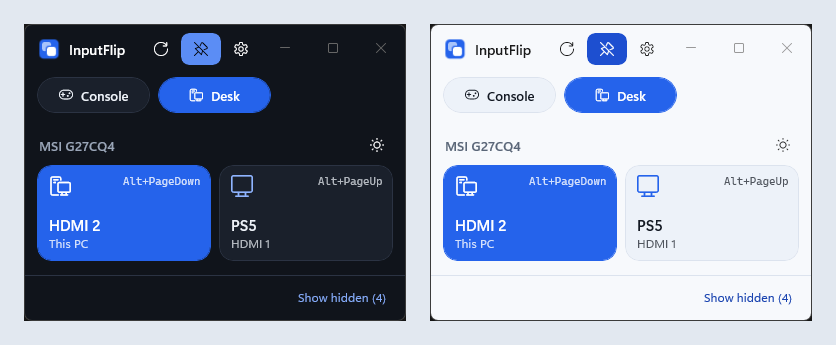

# InputFlip

**Switch your monitor's input from Windows: one click, a hotkey, a scene or a script.** Flip one monitor between your
PC, a PS5, Xbox or Nintendo Switch, a work laptop or a Mac without reaching for the buttons on the back of the screen.

InputFlip is a free, open-source Windows 10/11 app. It talks to your monitor over **DDC/CI**, the control channel
inside the HDMI, DisplayPort or USB-C cable, and sends the standard "Input Source" command (**VCP code `0x60`**). No
driver, no extra hardware, no account.



[](LICENSE)


## What it does

- **Switch inputs with one click.** Each monitor shows its inputs as tiles (HDMI 1, HDMI 2, DisplayPort, USB-C). The
  input on screen now is blue. Name them ("PS5", "Work laptop") and give them icons.
- **Hotkeys that work anywhere**, even in a game: one per input, and a toggle that flips between two inputs (PC and
  PS5) with the same key.
- **Scenes:** switch several monitors at once, and set their brightness. Press the scene again to go back.
- **Pop-up picker:** a hotkey opens a small list next to the mouse; arrow keys and Enter, or 1 to 9.
- **Tray icon** with every scene and input in its menu.
- **Command line and `inputflip://` links** for scripts, desktop shortcuts, AutoHotkey and **Stream Deck**.
- **USB auto-switch (software KVM):** when a USB device (your keyboard on a USB switch box) leaves this PC, switch the
  monitor to the other computer, and back when it returns.
- **Lock and sleep rules:** switch to the console when the PC locks or sleeps, and back when you return.
- **Brightness, contrast and speaker volume** for each monitor, over the same cable.
- **The mouse gets out of the way:** when the monitor you're on switches to the console, the mouse moves to a screen
  you can still see, and comes back when you switch back.
- Knows which input **this PC** is on, from the cable type Windows reports.
- Light and dark mode, full keyboard control, works with Narrator. No telemetry.

## Who it's for

- A gaming PC and a **PS5, Xbox or Switch on the same monitor**, with the PC's controls on another screen.
- A desktop and a **work laptop** sharing one or two monitors, with a USB switch for the keyboard and mouse: a cheap
  **KVM alternative**.
- A **Mac and a PC** on one monitor (run InputFlip on the PC side).
- Anyone who's tired of the joystick under their monitor.

## Install

1. Download **`InputFlip-Setup.exe`** from the [latest release](https://github.com/undah/inputflip/releases/latest).
2. Run it. It installs for your user only (no admin rights), with Start menu and desktop shortcuts. Everything it
   needs (.NET and the Windows App SDK) is inside.
3. The installer isn't code-signed yet, so Windows SmartScreen may warn the first time: click **More info**, then
   **Run anyway**.

Prefer not to install? `InputFlip-Portable.zip` runs from any folder. Uninstall from Settings › Apps; your settings
stay in `%LOCALAPPDATA%\InputFlip`.

**Before you start:** turn on **DDC/CI** in your monitor's on-screen menu, if it has the option (often under System,
Setup or Other). Many monitors have it on already.

## Quick start

1. Open InputFlip. The first time, a short setup shows the monitors it found, whether each one answers, and lets you
   name your inputs ("PS5") and pick shortcuts. You can skip it.
2. Click a tile to switch that monitor. Right-click a tile to rename it, change its icon, hide it, or tell InputFlip
   which input this PC is on.
3. Keep InputFlip on a screen that stays on the PC (it opens on a side monitor the first time), or use a hotkey.
4. Want more? **Settings › Scenes** (several monitors at once), **Settings › Rules** (USB, lock, sleep),
   **Settings › Shortcuts**.

The full walkthrough is in the [user guide](docs/user-guide.md).

## Keyboard shortcuts

| Keys | What it does |
|---|---|
| `Ctrl+Alt+Shift+I` | Switch to the next input (with two inputs shown: flip between them) |
| `Ctrl+Alt+Shift+P` | Pop-up picker by the mouse |
| `Ctrl+Alt+Shift+S` | Bring the InputFlip window to the front |
| Your own | One per input and one per scene, set in Settings › Shortcuts |

In the window: arrow keys move between tiles, Enter switches, `Shift+F10` opens a tile's menu, `F5` refreshes,
`Ctrl+,` opens Settings. The defaults avoid `Ctrl+Alt+letter`, which is AltGr on many keyboard layouts.

## Command line, links and Stream Deck

```powershell
InputFlip.exe --switch MSI PS5          # monitor (name, number or "main") and input (name, port or value)
InputFlip.exe --switch "HDMI 2"         # an input on the main monitor
InputFlip.exe --scene Console           # run a scene
InputFlip.exe --toggle                  # same as the next-input shortcut
InputFlip.exe --brightness all -10      # 0 to 100, or a step: +10, -10
InputFlip.exe --list                    # monitors, inputs and scenes, to write scripts from
```

The same works as a link, for a Stream Deck "Website" action, a browser bookmark or a desktop shortcut:
`inputflip://switch/MSI/PS5`, `inputflip://scene/Console`, `inputflip://toggle`. Commands go to the copy that's
already running, so they're instant. Exit codes: 0 done, 1 didn't work, 2 typo in the command.
Everything is in [docs/command-line.md](docs/command-line.md).

## Does my monitor work?

Most monitors made in the last ten years support DDC/CI, and most of those let software change the input. Some
things to know:

- **HDMI is the safest bet.** Some monitors answer DDC/CI over HDMI but not (or not reliably) over DisplayPort. The
  MSI G27CQ4 is one: perfect over HDMI, ignores commands over DisplayPort while it shows it.
- **Docks, KVM switches, USB-C hubs and adapters** often don't pass DDC/CI through. Plug the monitor straight into
  the graphics card to test.
- **TVs** generally don't support DDC/CI (they use HDMI-CEC, which PC graphics cards don't send).
- **Laptop screens** can't switch inputs; external monitors connected to a laptop can.
- **Some LG monitors** expect input commands on a different DDC/CI address than Windows uses, so the switch is
  ignored. Not supported yet.
- **Some monitors can't switch back** once they show another device, because they stop listening on the PC's input.
  InputFlip has a workaround for one kind of this ("turn the screens off when leaving"); see the
  [DDC/CI notes](docs/ddc-ci-notes.md#switch-back-problem).

The [compatibility list](docs/compatibility.md) has monitors people have tested. Tried yours? Please
[add it](https://github.com/undah/inputflip/issues/new?template=monitor_report.yml), whether it worked or not.

## Troubleshooting

| What you see | What to try |
|---|---|
| "Not answering" under a monitor | Turn on DDC/CI in the monitor's menu. Try another cable type (HDMI instead of DisplayPort). Unplug docks and adapters. |
| Some inputs listed don't exist | Monitors report the inputs of their whole model range. Right-click the tile › Hide. |
| An input is missing | Settings › Monitors › Add input, by its value (`0x11` is HDMI 1, `0x0F` DisplayPort 1; see the [table](docs/ddc-ci-notes.md#standard-input-values-mccs)). |
| "Didn't switch" | The monitor heard the command but stayed. Some monitors ignore commands for a few seconds after waking or switching; try again. Check the [DDC/CI notes](docs/ddc-ci-notes.md). |
| It switched, but the picture takes 5 seconds | That's the monitor and the other device redoing their HDMI handshake. InputFlip's part takes about 0.1 s. See the FAQ. |
| A shortcut doesn't work | Settings › Shortcuts says why (another app has it, or two shortcuts clash). |
| Something else | Settings › About › Open log, and Copy all under Diagnostics, then [open an issue](https://github.com/undah/inputflip/issues/new/choose). |

## FAQ

**Is this a KVM switch?** It replaces the video part of one. Pair it with a cheap USB switch for the keyboard and mouse
and a USB rule (Settings › Rules), and pressing the USB switch's button moves everything: a software KVM.

**Why does the picture take a few seconds to show after a switch?** The command goes out within milliseconds and the
monitor confirms it in about 0.15 s. Then the monitor and the device on the new input go through HDMI's handshake (and
HDCP for consoles), which can take 2 to 6 seconds on some monitors and consoles, whatever sends the command. The
monitor's own buttons are just as slow.

**Can I switch back to the PC while the monitor shows the console?** Yes, on most monitors: they keep listening on
the PC's cable while showing another input. Use a hotkey, the tray icon, or InputFlip's window on another screen.

**HDMI or DisplayPort?** Both can carry DDC/CI. In practice HDMI is more reliable for switching. If your monitor
ignores InputFlip over DisplayPort, try HDMI before giving up on it.

**Does it need admin rights or a driver?** No. It uses the DDC/CI functions built into Windows (`dxva2.dll`).

**Does it send anything over the internet?** No. No telemetry, no account. The only network access is checking for
updates, and only if you point it at a web address.

**Mac or Linux?** InputFlip is Windows only. On macOS, MonitorControl or BetterDisplay; on Linux, `ddcutil`.

## Alternatives

| Tool | Good at | Compared with InputFlip |
|---|---|---|
| [ControlMyMonitor](https://www.nirsoft.net/utils/control_my_monitor.html) (NirSoft) | Every VCP code, command line | No hotkeys, scenes or rules; a power-user tool |
| [Monitorian](https://github.com/emoacist/Monitorian) | Brightness for several monitors | Brightness only, no input switching |
| [Twinkle Tray](https://github.com/xanderfrangos/twinkle-tray) | Brightness from the tray | Brightness first; input switching isn't its focus |
| [display-switch](https://github.com/haimgel/display-switch) | USB-triggered switching | Config file only, no window; InputFlip does this plus a UI |
| [ddcutil](https://www.ddcutil.com/) | DDC/CI on Linux | Linux only |
| Monitor makers' apps (Dell Display Manager, LG OnScreen Control, MSI Display Kit...) | Their own models | One brand each |
| A hardware KVM switch | Switching everything, any monitor | Costs money, adds cables, can block DDC/CI and high refresh rates |

## Build from source

You need Windows 10 or 11 and the [.NET 10 SDK](https://dotnet.microsoft.com/download/dotnet/10.0):

```powershell
winget install Microsoft.DotNet.SDK.10
git clone https://github.com/undah/inputflip.git
cd inputflip
dotnet test
dotnet run --project src/InputFlip
```

To test without switching your monitors: `dotnet run --project src/InputFlip -- --data-dir %TEMP%\if-test --no-switch`.
The installer is built with `scripts/build-installer.ps1` (needs `vpk`, Velopack's tool). Details in
[CONTRIBUTING.md](CONTRIBUTING.md).

## Docs

| | |
|---|---|
| [User guide](docs/user-guide.md) | Every window, setting and feature |
| [Command line and links](docs/command-line.md) | `--switch`, `inputflip://`, Stream Deck, AutoHotkey |
| [Compatibility](docs/compatibility.md) | Monitors people have tested |
| [DDC/CI notes](docs/ddc-ci-notes.md) | How DDC/CI works, input values, DisplayPort quirks, the switch-back problem |
| [Architecture](docs/architecture.md) | How the code is put together |
| [Plan and history](docs/plan.md) | How the app was built, with every test on real hardware |

## Contributing

Bug reports, monitor reports and pull requests are welcome. Start with [CONTRIBUTING.md](CONTRIBUTING.md). Please
follow the [code of conduct](CODE_OF_CONDUCT.md). Security problems: see [SECURITY.md](SECURITY.md).

## License

[MIT](LICENSE). InputFlip was called Switchboard during development; you may still see that name in the history and
in the install folder (`%LOCALAPPDATA%\SwitchboardApp`).
