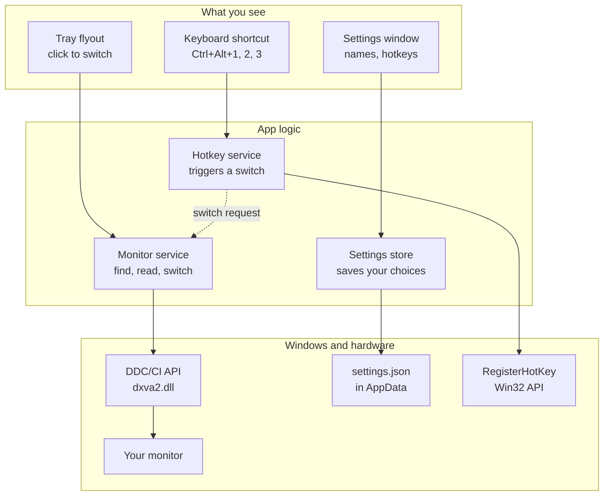

# Architecture



The hotkey service hands its switch requests to the monitor service, so a shortcut and a click take the same path to the monitor.

## Components

### Monitor service
- Enumerates physical monitors: `EnumDisplayMonitors` → `GetNumberOfPhysicalMonitorsFromHMONITOR` → `GetPhysicalMonitorsFromHMONITOR`.
- Identifies monitors by EDID model + serial (WMI `root\wmi:WmiMonitorID`) so settings follow the monitor, not the port order.
- Reads capabilities: `GetCapabilitiesStringLength` + `CapabilitiesRequestAndCapabilitiesReply`, then parses the `vcp(... 60(0F 11 12) ...)` section.
- Reads current input: `GetVCPFeatureAndVCPFeatureReply(handle, 0x60, ...)`.
- Switches input: `SetVCPFeature(handle, 0x60, value)`.
- All DDC/CI calls go through a per-monitor serial queue on a background thread, with retries and timeouts. Never call DDC/CI from the UI thread.
- Listens for display changes and re-enumerates.
- Releases handles with `DestroyPhysicalMonitors`.

### Settings store
- `%LOCALAPPDATA%\Switchboard\settings.json`
- Per monitor (keyed by EDID id): nickname, inputs (value, name, icon, hidden, order), hotkeys.
- Global: start with Windows, theme, flyout position.

### Hotkey service
- `RegisterHotKey` on a hidden message window.
- Per-input hotkeys plus a "cycle inputs" hotkey.
- Detects conflicts (registration fails) and reports them to the settings UI.

### UI (WinUI 3)
- **Tray flyout:** H.NotifyIcon, borderless window anchored near the tray, Mica background.
- **Settings window:** NavigationView with General / Monitors / Hotkeys / About.
- **First-run wizard:** shown when settings.json doesn't exist.
- MVVM with CommunityToolkit.Mvvm.

## Planned repo layout

```
scripts/
  ddc-probe.ps1          Stage 1 discovery and switch test
src/
  Switchboard/           WinUI 3 app
    Services/            MonitorService, HotkeyService, SettingsStore
    Interop/             dxva2 and user32 P/Invoke
    ViewModels/
    Views/               Flyout, SettingsWindow, Setup wizard
tests/
  Switchboard.Tests/     Capabilities-string parser, settings round-trip
docs/
```
