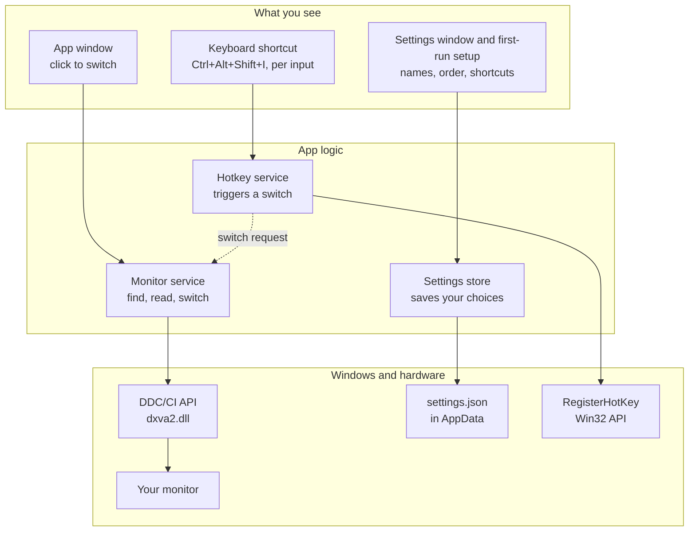

# Architecture



The hotkey service hands its switch requests to the monitor service, so a shortcut and a click take the same path to the monitor.

## Components

### Monitor service
- Enumerates physical monitors: `EnumDisplayMonitors` → `GetNumberOfPhysicalMonitorsFromHMONITOR` → `GetPhysicalMonitorsFromHMONITOR`.
- Identifies monitors by EDID manufacturer, product code and serial, read from the copy Windows caches in the registry, so settings follow the monitor, not the port order. Ids look like `MSI3CB0-000000D1`.
- Reads capabilities: `GetCapabilitiesStringLength` + `CapabilitiesRequestAndCapabilitiesReply`, then parses the `vcp(... 60(0F 11 12) ...)` section.
- Reads current input: `GetVCPFeatureAndVCPFeatureReply(handle, 0x60, ...)`.
- Switches input: `SetVCPFeature(handle, 0x60, value)`.
- All DDC/CI calls go through a per-monitor serial queue on a background thread, with retries and timeouts. Never call DDC/CI from the UI thread. On the owner's PC calls to *different* monitors also wait for each other (see ddc-ci-notes.md), so keep DDC/CI traffic to what's needed: capabilities strings are kept in `capabilities.json` between runs, and the quick re-read when the window is activated skips hidden monitors and waits 300 ms so it doesn't land in front of a click's switch.
- A switch sends the command before anything else (the window, the mouse, the log), then reads the input back right away and every 100 ms for up to 2 s. A newer switch on the same monitor ends an older one's read-back (`SwitchStatus.Superseded`). The log line for each switch says how long after the key or click the command went out and when it was confirmed.
- Reads each display's cable type (DisplayPort, HDMI...) from `QueryDisplayConfig`, matched to the monitor by its device interface path. Used for the setup's screens-off suggestion and shown in Settings.
- Listens for display changes and re-enumerates.
- `ReadOnly` (the `--no-switch` option) blocks every switch command; reads still work.
- Releases handles with `DestroyPhysicalMonitors`.

### Settings store
- `%LOCALAPPDATA%\Switchboard\settings.json`
- Per monitor (keyed by EDID id, listed in display order): nickname, hidden, the screens-off input, inputs (value, name, icon, hidden, hotkey; listed in display order).
- Global: theme, always on top, window position, the show and cycle shortcuts and the cycle monitor, `leaveMouseAlone` (turns off moving the mouse when a monitor switches away from the PC).
- `capabilities.json` next to it: each monitor's capabilities string, so it's read once, not at every start.
- Start with Windows lives in the registry (HKCU Run), where Windows and Task Manager read it.
- The settings window's edits are pure functions in `Core/Settings/SettingsEditor.cs` (reorder, add, remove...), unit-tested.
- `--data-dir` or `SWITCHBOARD_DATA_DIR` points the app at another folder (testing, first-run setup).

### Hotkey service
- `RegisterHotKey` on a hidden message window.
- Per-input hotkeys plus "cycle inputs" and "show window". `Core/Hotkeys/ShortcutSlots.cs` names each place a shortcut lives ("show", "cycle", "input:<monitor>:0x11").
- Reports, per shortcut, a typo, a duplicate, or a combination another app already registered; Settings › Shortcuts shows it next to the shortcut.
- The recorder unregisters all of Switchboard's hotkeys while it listens, so pressing one records it instead of switching, and test-registers the new combination to see whether another app has it.

### UI (WinUI 3)
- **App window** (`MainWindow`): fixed width, sized to its content, Mica background, our header as the title bar (refresh, pin, settings). Each monitor is a card of input rows; the input showing now has the accent fill. A switch moves the fill at once; the monitor's confirmation comes a moment later and only shows if something's wrong (status line), or as a spinner on the row if it takes over 400 ms. Narrator still hears "switched to ..." as a notification. Opens where it was last left; closing quits. Not a tray app: the owner keeps it open on an Acer, because the tray lives on the MSI's taskbar, which disappears when the MSI shows the PS5.
- **Settings window** (`SettingsWindow`): NavigationView with General / Monitors / Shortcuts / About pages (`Pages/`). Changes apply and save at once.
- **First-run setup** (`SetupWindow`): shown when settings.json doesn't exist. Monitors found, input names and icons, the screens-off suggestion when a monitor needs it, shortcuts. Skippable; About › Run setup opens it again.
- **Host window** (`Native/HostWindow.cs`): hidden Win32 window for global hotkeys, display changes and resume from sleep.
- **Styles** (`Styles.xaml`): every color is a WinUI theme resource, so light, dark and the accent color follow Windows or the theme picked in Settings.
- MVVM with CommunityToolkit.Mvvm: `MainViewModel` for the app window, `SettingsViewModel` for settings and setup (it re-syncs in place when settings or monitors change, so a text box you're typing in keeps its text).

### Packaging
- `Program.Main` runs Velopack's install hooks (the uninstall hook removes the start-with-Windows entry), reads the options, then starts WinUI.
- `scripts/build-installer.ps1`: tests, `dotnet publish` (Release, self-contained: .NET and the Windows App SDK ship inside), drops the Windows App SDK's unused AI runtime, `vpk pack` into `releases/`.

## Repo layout

```
scripts/
  ddc-probe.ps1          Stage 1 discovery and switch test
  nvapi-probe.ps1        Stage 1 test of NVIDIA's own I2C route
  quiet-link-test.ps1    Stage 1 screens-off switch test
  build-installer.ps1    Release build and Velopack installer
src/
  Switchboard.Core/      No UI; unit-tested
    Branding/            The app icon, drawn in code; writes the .ico
    Interop/             dxva2, user32 and QueryDisplayConfig P/Invoke
    Ddc/                 Capabilities-string parser, input names (MCCS table)
    Monitors/            Enumeration, EDID, per-monitor DDC/CI queue, MonitorService
    Hotkeys/             Shortcut parsing ("Ctrl+Alt+Shift+I"), shortcut slots
    Settings/            settings.json model and store, input list logic, settings edits, setup advice, start with Windows
    StartupOptions.cs    --data-dir, --no-switch, --open, --export-icon
  Switchboard/           WinUI 3 app
    Program.cs           Main: Velopack hooks, options
    Assets/              Switchboard.ico
    Controls/            Settings card, input list editor, shortcut recorder
    Native/              Hidden host window, window chrome (title bar, Mica, theme)
    Pages/               Settings pages
    ViewModels/
    AppController.cs     Owns the services and windows, keeps the view models in step
    MainWindow.xaml      The app window
    SettingsWindow.xaml  Settings
    SetupWindow.xaml     First-run setup
    Styles.xaml          Shared styles
tests/
  Switchboard.Core.Tests/
docs/
```
