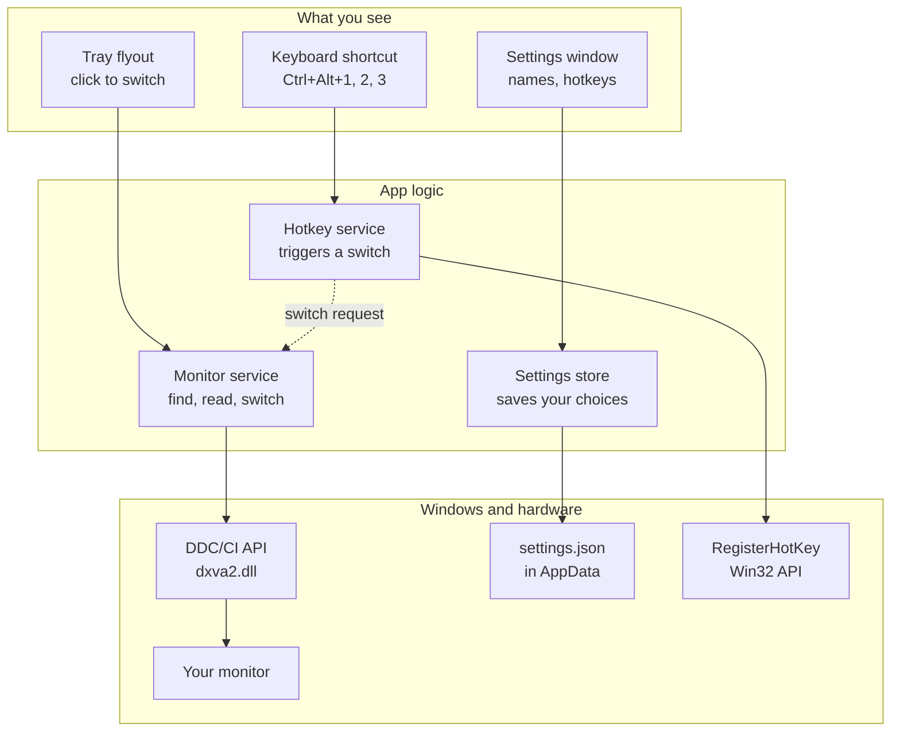

# Architecture



The hotkey service hands its switch requests to the monitor service, so a shortcut and a click take the same path to the monitor.

## Components

### Monitor service
- Enumerates physical monitors: `EnumDisplayMonitors` → `GetNumberOfPhysicalMonitorsFromHMONITOR` → `GetPhysicalMonitorsFromHMONITOR`.
- Identifies monitors by EDID manufacturer, product code and serial, read from the copy Windows caches in the registry, so settings follow the monitor, not the port order. Ids look like `MSI3CB0-000000D1`.
- Reads capabilities: `GetCapabilitiesStringLength` + `CapabilitiesRequestAndCapabilitiesReply`, then parses the `vcp(... 60(0F 11 12) ...)` section.
- Reads current input: `GetVCPFeatureAndVCPFeatureReply(handle, 0x60, ...)`.
- Switches input: `SetVCPFeature(handle, 0x60, value)`.
- All DDC/CI calls go through a per-monitor serial queue on a background thread, with retries and timeouts. Never call DDC/CI from the UI thread.
- Listens for display changes and re-enumerates.
- Releases handles with `DestroyPhysicalMonitors`.

### Settings store
- `%LOCALAPPDATA%\Switchboard\settings.json`
- Per monitor (keyed by EDID id): nickname, inputs (value, name, icon, hidden, order), hotkeys.
- Global: start with Windows, theme, flyout position.

### Hotkey service
- `RegisterHotKey` on a hidden message window.
- Per-input hotkeys plus a "cycle inputs" hotkey.
- Detects conflicts (registration fails) and reports them to the settings UI.

### UI (WinUI 3)
- **Tray icon:** our own `Shell_NotifyIcon` code on a hidden Win32 window (`Native/HostWindow.cs`), which also receives hotkeys, display changes, resume from sleep and theme changes. The icon is drawn in code in white or black to match the taskbar.
- **Switch window** (`FlyoutWindow`): borderless, always on top, acrylic background, anchored above the tray; hides when you click elsewhere. With the pin on, it stays open and can be dragged by its header.
- **Settings window:** NavigationView with General / Monitors / Hotkeys / About.
- **First-run wizard:** shown when settings.json doesn't exist.
- MVVM with CommunityToolkit.Mvvm.

## Repo layout

```
scripts/
  ddc-probe.ps1          Stage 1 discovery and switch test
  nvapi-probe.ps1        Stage 1 test of NVIDIA's own I2C route
src/
  Switchboard.Core/      No UI; unit-tested
    Interop/             dxva2 and user32 P/Invoke
    Ddc/                 Capabilities-string parser, input names (MCCS table)
    Monitors/            Enumeration, EDID, per-monitor DDC/CI queue, MonitorService
    Hotkeys/             Shortcut parsing ("Ctrl+Alt+Shift+I")
    Settings/            settings.json model and store, input list logic
  Switchboard/           WinUI 3 app
    Native/              Hidden host window, tray icon, icon drawing
    ViewModels/
    AppController.cs     Owns the services, keeps the view model in step
    FlyoutWindow.xaml    The switch window
tests/
  Switchboard.Core.Tests/
docs/
```
