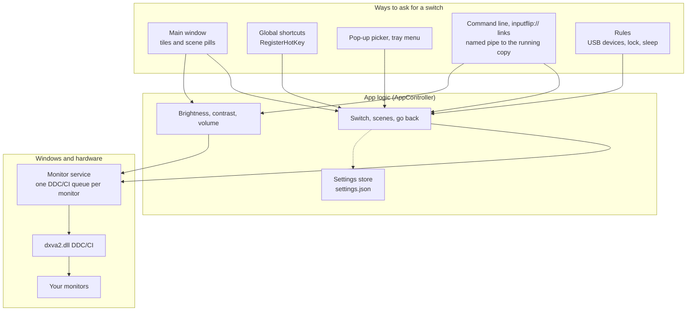

# Architecture



Every way of asking for a switch ends in the same `AppController.SwitchAsync`, so a click, a shortcut, a scene, a rule
and a command behave the same: the command goes out first, the window follows, the monitor confirms.

## Projects

- **`src/InputFlip.Core`**: no UI, unit-tested. DDC/CI interop and the monitor service, EDID, capabilities strings,
  settings, scenes, commands, USB rules, the icon drawing.
- **`src/InputFlip`**: the WinUI 3 app (Windows App SDK 1.8, unpackaged, self-contained).
- **`tests/InputFlip.Core.Tests`**: xUnit.

## Components

### Monitor service (`Core/Monitors`)
- Enumerates physical monitors: `EnumDisplayMonitors` → `GetNumberOfPhysicalMonitorsFromHMONITOR` →
  `GetPhysicalMonitorsFromHMONITOR`. A handle can be `0`; "has a handle" is tracked separately.
- Identifies monitors by EDID manufacturer, product code and serial, read from the copy Windows caches in the registry
  (`HKLM\SYSTEM\CurrentControlSet\Enum\DISPLAY\...\Device Parameters\EDID`), so settings follow the monitor, not the
  port order. Ids look like `MSI3CB0-000000D1`.
- Reads capabilities strings (`GetCapabilitiesStringLength` + `CapabilitiesRequestAndCapabilitiesReply`) and parses
  the `vcp(... 60(0F 11 12) ...)` input list and the other codes (brightness `10`, contrast `12`, volume `62`, mute
  `8D`). Kept in `capabilities.json`: reading one takes seconds and blocks other DDC/CI calls.
- Reads and writes VCP codes (`GetVCPFeatureAndVCPFeatureReply`, `SetVCPFeature`) through a per-monitor serial queue
  (`DdcChannel`) on a background thread, with retries and timeouts. Never from the UI thread.
- A switch sends the command before anything else, then reads the input back right away and every 100 ms for up to
  2 s. A newer switch on the same monitor ends the older one's read-back (`SwitchStatus.Superseded`). The log says how
  long after the key or click the command went out and when it was confirmed.
- Reads each display's cable type (DisplayPort, HDMI...) from `QueryDisplayConfig`, to find which input is this PC's
  (`Settings/PcInputDetector.cs`) and for the setup's screens-off suggestion.
- `ReadOnly` (the `--no-switch` option) blocks every command; reads still work.
- On some PCs DDC/CI calls to different monitors wait for each other (one queue in the driver), so DDC/CI traffic is
  kept to what's needed: capabilities are cached, hidden monitors aren't re-read, slider values never pile up
  (`LatestValueSender`).

### Actions (`Core/Actions`)
- `ScenePlanner`: what a scene does to the connected monitors, whether it's showing now, and the restore point for
  going back.
- `AppAction`: what a rule does, as text in settings.json (`scene:console`, `switch:<monitor>:0x11`, `back`).
- `RemoteCommand`: the command line and `inputflip://` links, parsed into one form. `TargetResolver` finds the
  monitor and input from what was typed (name, port, value, number, `main`, `pc`).
- `PickerItems`: what the pop-up picker and the tray menu list.

### Settings (`Core/Settings`)
- `settings.json` in `%LOCALAPPDATA%\InputFlip` (or `%LOCALAPPDATA%\Switchboard` on PCs that used 1.0; see
  `AppPaths.PickDefault`). Comments and trailing commas allowed; a file with a mistake is never overwritten; edits on
  disk reload by themselves.
- The settings window's edits are pure functions in `SettingsEditor`, unit-tested.
- Start with Windows: the `InputFlip` value under HKCU `Run` (`StartupRegistration`; moves a 1.0 `Switchboard` value).
- `inputflip://` links: HKCU `Software\Classes\inputflip` (`LinkRegistration`), registered at start, removed on
  uninstall.

### USB rules (`Core/Usb`)
- The host window registers for `GUID_DEVINTERFACE_USB_DEVICE` notices (`RegisterDeviceNotification`).
  `UsbDeviceId` reads vendor, product and serial from the device path; `UsbRuleEngine` matches rules and runs each
  action once per burst (a USB switch box moves several devices at once).
- `Interop/UsbDevices` lists plugged-in devices (SetupAPI) with the name they report, for the rule editor.

### Hotkeys (`Core/Hotkeys`)
- `RegisterHotKey` on the hidden host window. `ShortcutSlots` names each place a shortcut lives (`show`, `cycle`,
  `picker`, `scene:<id>`, `input:<monitor>:0x11`) and finds conflicts. The recorder pauses all of InputFlip's hotkeys
  while it listens and test-registers the new combination to see whether another app has it.

### The app (`src/InputFlip`)
- **`Program.cs`:** Velopack hooks (the uninstall hook removes the start-up entry and the links), options, and the
  command client: a start with a command sends it to the running copy over a named pipe (`CommandPipeHost`, current
  user only) and prints the answer; with nothing running it starts the app and runs the command after the first look
  at the monitors.
- **`AppController`** (and `AppController.Features.cs`): owns the services, windows and view models; switching,
  scenes, rules, levels, the tray menu, the toast and the picker.
- **`MainWindow`:** the tiles (an `ItemsRepeater` with a two-column `UniformGridLayout`), scene pills, the levels panel.
  The tile flip is a Composition animation (`Motion.cs`), not a XAML transition: those crashed on theme changes.
- **`PickerWindow`, `ToastWindow`:** borderless top-most windows. The toast never takes focus (`WS_EX_NOACTIVATE`) and
  goes on a screen that didn't switch (`ToastPlacement`).
- **`SettingsWindow`** (General, Monitors, Scenes, Rules, Shortcuts, About) and **`SetupWindow`** (first run).
- **`Native/HostWindow`:** a hidden Win32 window for hotkeys, display changes, sleep and wake, lock and unlock
  (`WTSRegisterSessionNotification`), USB notices and the tray icon (`Shell_NotifyIcon`, version 4).
- **`Styles.xaml`:** the "Tiles" look: theme dictionaries for dark, light and high contrast, and the blue that also
  replaces the Windows accent color in standard controls. Theme-dependent colors are switched through Styles, never
  brushes looked up in code.
- **`Updater`:** Velopack; GitHub releases by default (`GithubSource`), or a folder or web address from
  `updateSource`.

### Packaging
- `scripts/build-installer.ps1`: tests, `dotnet publish` (Release, self-contained), drops the Windows App SDK's unused
  AI runtime (~42 MB), `vpk pack` into `releases/`, copies the downloads to `InputFlip-Setup.exe` and
  `InputFlip-Portable.zip`, and with `-Publish` creates the GitHub release.
- The Velopack pack id is `SwitchboardApp` (the name during development), kept so installed copies keep updating.

## Repo layout

```
.github/                 Issue forms, pull request template, CI
docs/                    User guide, command line, compatibility, DDC/CI notes, this file, plan and history
scripts/
  build-installer.ps1    Release build, Velopack installer, GitHub release
  ddc-probe.ps1          Stage 1 discovery and switch test (no build needed)
  nvapi-probe.ps1        Stage 1 test of NVIDIA's own I2C route
  quiet-link-test.ps1    Stage 1 screens-off switch timing test
src/
  InputFlip.Core/        No UI; unit-tested
    Actions/             Scenes, rule actions, commands and links, picker items
    Branding/            The app icon, drawn in code
    Ddc/                 Capabilities parser, input names (MCCS table), VCP codes
    Hotkeys/             Shortcut parsing, shortcut slots
    Interop/             dxva2, user32, QueryDisplayConfig, SetupAPI
    Monitors/            Enumeration, EDID, DDC/CI queue, MonitorService, mouse parking, toast placement
    Settings/            settings.json, input list, edits, setup advice, start-up entry, links
    Usb/                 USB device ids and rules
  InputFlip/             WinUI 3 app
    Controls/            Settings card, input list editor, shortcut recorder, logo
    Native/              Host window, command pipe, window chrome
    Pages/               Settings pages
    ViewModels/
tests/
  InputFlip.Core.Tests/
```
