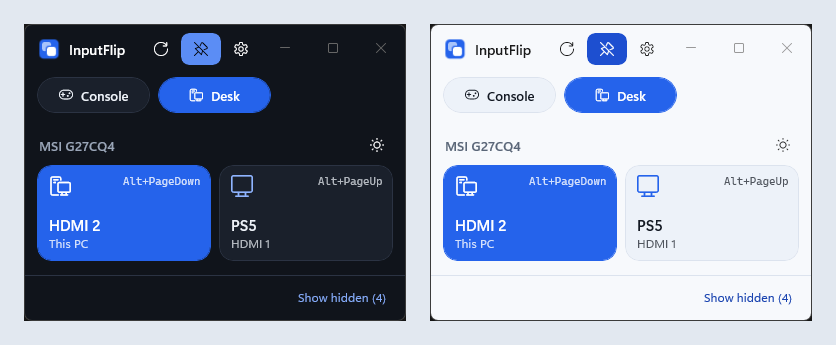

# InputFlip user guide

InputFlip switches which input your monitor shows (HDMI, DisplayPort, USB-C) from Windows. This guide covers every
window and setting. For a quick overview, see the [README](../README.md).

- [Before you start](#before-you-start)
- [First run](#first-run)
- [The main window](#the-main-window)
- [Shortcuts](#shortcuts)
- [Scenes](#scenes)
- [The pop-up picker, the tray icon and the note after a switch](#the-pop-up-picker-the-tray-icon-and-the-note-after-a-switch)
- [Brightness, contrast and volume](#brightness-contrast-and-volume)
- [Rules: USB devices, lock and sleep](#rules-usb-devices-lock-and-sleep)
- [The mouse](#the-mouse)
- [Monitors that won't switch away from the PC](#monitors-that-wont-switch-away-from-the-pc)
- [Settings](#settings)
- [The settings file](#the-settings-file)
- [Updates, uninstalling and where things are kept](#updates-uninstalling-and-where-things-are-kept)

## Before you start

- **DDC/CI on.** Most monitors have it on. If yours has the option, it's in the on-screen menu, often under System,
  Setup or Other settings.
- **A direct cable** from the graphics card to the monitor. Docks, USB-C hubs, KVM switches and some adapters don't
  pass DDC/CI through.
- **HDMI if you can.** Some monitors only take commands over HDMI. If one doesn't answer over DisplayPort, try HDMI.

## First run

The first time, InputFlip opens on a monitor other than your main one, with a short setup:

1. **Your monitors:** what InputFlip found, the cable Windows reports, and whether each answers DDC/CI.
2. **Name your inputs:** "PS5", "Work laptop", with an icon. Untick inputs you don't use (monitors often list ports
   they don't have).
3. **Only for some monitors:** the screens-off switch (see [below](#monitors-that-wont-switch-away-from-the-pc)).
4. **Shortcuts.**

Every page can be skipped. Settings › About › Run setup opens it again.

## The main window



- **Each monitor** has a heading and its inputs as tiles. The tile showing now is blue, and flips over when it
  becomes the one showing.
- **Click a tile** to switch. The tile turns blue at once; if the monitor doesn't confirm, a message at the bottom
  says so.
- **"This PC"** marks the input this computer is plugged into. Monitors can't report which ports have something
  connected, so InputFlip works it out from the cable type Windows reports. If it guessed wrong, right-click the
  right tile › *This PC is plugged in here*.
- **Right-click a tile** (or `Shift+F10`): rename, icon, *This PC is plugged in here*, the screens-off switch, hide.
- **Right-click a monitor's name:** hide the monitor, or open its settings.
- **The sun button** next to a monitor's name opens [brightness, contrast and volume](#brightness-contrast-and-volume).
- **Scenes** show as pills above the monitors.
- **Title bar:** refresh (`F5`), keep on top (the pin), settings (`Ctrl+,`). An **Update** button appears when a new
  version is out.
- **Show hidden** at the bottom shows hidden monitors and inputs, faded, so you can bring them back.

Closing the window quits InputFlip, unless you turned on *Closing the window keeps InputFlip running* (Settings ›
General). It opens where you left it.

**Keyboard:** `Tab` moves into the tiles, arrow keys move between them, `Enter` switches. Narrator reads each tile
("Switch to PS5", "HDMI 2, showing now") and announces switches.

## Shortcuts

Shortcuts work anywhere while InputFlip runs, even in a full-screen game.

| Shortcut | Default |
|---|---|
| Switch to the next input (with two inputs shown: flip between them) | `Ctrl+Alt+Shift+I` |
| Open the pop-up picker | `Ctrl+Alt+Shift+P` |
| Bring InputFlip to the front | `Ctrl+Alt+Shift+S` |
| One per input, one per scene | none |

Change them in Settings › Shortcuts: click a shortcut, press the new keys. InputFlip refuses keys another app already
uses, or another InputFlip shortcut, and says which. `Esc` cancels, `Backspace` clears.

**The toggle:** the next-input shortcut goes through the shown inputs of one monitor. Hide the inputs you don't use
and keep two shown (PC and PS5), and it flips between them. Settings › Shortcuts picks which monitor; automatic means
the main display, or the first monitor with two inputs shown.

## Scenes

A scene switches several monitors at once, and can set their brightness: "Console" puts the middle monitor on the
PS5 and dims the side ones; "Desk" puts everything back on the PC.

- **Make one:** put your monitors on the inputs you want, then Settings › Scenes › **Save what's showing now**. Or
  **Add an empty scene** and pick an input (or *Leave it as it is*) and a brightness for each monitor.
- **Run it:** click its pill in the main window, give it a shortcut (Settings › Shortcuts), pick it in the pop-up
  picker or the tray menu, or `InputFlip.exe --scene Console`.
- **Go back:** run a scene that's showing (its pill is blue) and InputFlip puts back what the monitors showed before.
- Monitors that aren't connected are skipped, and InputFlip says which.

## The pop-up picker, the tray icon and the note after a switch

**Pop-up picker** (`Ctrl+Alt+Shift+P`): a small list next to the mouse with your scenes and every shown input. It opens
with the likely next choice selected. Arrow keys and `Enter`, or `1` to `9`; `Esc` or a click elsewhere closes it.

**Tray icon:** click it to open InputFlip; right-click it for scenes, every monitor's inputs (the current one ticked),
the picker, settings and quit. Windows shows tray icons on the main display's taskbar only, so if your main display
is the one that switches to a console, keep the window or a shortcut handy too. Turn the icon off in Settings ›
General.

**The note after a switch:** after a switch from a shortcut, a scene, a rule, the picker or the command line, a short
note ("PS5 / MSI G27CQ4") shows at the bottom of a screen you can still see for two seconds. Not after clicks in the
window, which shows the change itself. Turn it off in Settings › General.

## Brightness, contrast and volume

The sun button next to a monitor's name opens sliders for **brightness**, **contrast** and, on monitors with
speakers, **volume** and **mute**. InputFlip reads the current levels when you open it, and only shows what the
monitor says it supports.

Dragging a slider sends at most one command at a time, so it never piles up commands that would hold up a switch.
Scenes can set brightness, and so can the command line: `--brightness all -10`.

## Rules: USB devices, lock and sleep

Settings › Rules switches monitors by themselves.

### USB devices: a software KVM

With a **USB switch box** (a few euros or dollars), your keyboard and mouse move between this PC and another computer
at the press of its button. A USB rule makes the monitor follow:

1. Plug the USB switch box's devices in (they're on this PC), then Settings › Rules › **Add a USB rule**.
2. **Device:** pick the keyboard, mouse or receiver that moves with the switch. Plug it in and click *Refresh devices*
   if it isn't listed.
3. **When it leaves:** switch the monitor to the other computer's input (or run a scene).
4. **When it plugs in:** *Go back to what was showing before*, or switch to this PC's input.

Several devices on one switch box send several notices at once; InputFlip runs the same action only once within
3 seconds. Rules can be turned off without deleting them.

### Lock and sleep

Actions for when the PC **locks** (`Windows+L`, or after a while), **unlocks**, **goes to sleep** and **wakes up**. For
example: on lock, run "Console"; on unlock, go back. The sleep action is sent just before Windows sleeps; on some PCs
that's too fast for the monitor to hear it. The wake action waits a few seconds for the monitors to come back.

*Go back* puts back what the monitors showed before the last rule switched them.

## The mouse

When a monitor switches from this PC to another device with the mouse pointer on it, InputFlip moves the pointer to
its own window (or the main display), since Windows still counts the monitor as there and you'd lose the pointer on
it. Switching back puts the pointer where it was. Turn it off in Settings › General › *Move the mouse out of the way*.

## Monitors that won't switch away from the PC

A few monitors ignore commands while they show the PC's input over DisplayPort, but take them when the picture on
that cable stops. For those, right-click the PC's tile › *Turn screens off when leaving this input* (or Settings ›
Monitors). Switching away then turns all screens off for about 4 seconds, sends the command, and wakes them. Right
after, the monitor ignores commands for a few seconds, so a switch back in that time is re-sent until it takes.
Setup suggests this when a monitor answers over DisplayPort but lists no inputs. If you can, use HDMI instead. More in
the [DDC/CI notes](ddc-ci-notes.md#displayport).

## Settings

Every change applies and saves at once.

- **General:** start with Windows, light or dark (or follow Windows), keep on top, move the mouse out of the way, the
  tray icon, close to the tray, the note after a switch, edit the settings file.
- **Monitors:** names, order, which inputs show, icons, add an input by its value, the screens-off switch, the cable
  Windows reports, forget a monitor that isn't connected.
- **Scenes** and **Rules:** see above.
- **Shortcuts:** see above.
- **About:** version and updates, the log, the settings folder, run setup again, and **diagnostics**: what each
  monitor reports, including its capabilities string. Copy it into a bug or monitor report.

## The settings file

Settings live in `settings.json` (Settings › General › Edit). It's meant to be edited by hand too: comments and
trailing commas are fine, and InputFlip reloads it when you save. A file with a mistake is never overwritten;
InputFlip says which line and waits until it's fixed.

```jsonc
{
  "cycleHotkey": "Ctrl+Alt+Shift+I",
  "cycleMonitor": "MSI3CB0-000000D1",        // which monitor the toggle switches; leave out for the main display
  "pickerHotkey": "Ctrl+Alt+Shift+P",
  "showHotkey": "Ctrl+Alt+Shift+S",
  "theme": "dark",                            // "light", "dark", or leave out to follow Windows
  "alwaysOnTop": true,
  "leaveMouseAlone": false,                   // true: don't move the mouse when a monitor switches
  "hideTrayIcon": false,
  "closeToTray": false,
  "hideToasts": false,                        // true: no note after a switch
  "updateSource": "D:\\Shared\\InputFlip",    // where to look for updates; leave out for GitHub
  "scenes": [
    {
      "id": "console", "name": "Console", "icon": "console", "hotkey": "Ctrl+Alt+Shift+C",
      "steps": [
        { "monitor": "MSI3CB0-000000D1", "input": "0x11" },
        { "monitor": "ACR0673-83001C4F", "brightness": 30 }
      ]
    }
  ],
  "usbRules": [
    { "device": "VID_046D&PID_C52B", "name": "USB Receiver", "whenDisconnected": "scene:console", "whenConnected": "back" }
  ],
  "powerRules": { "onLock": "switch:MSI3CB0-000000D1:0x11", "onUnlock": "back" },
  "monitors": {
    "MSI3CB0-000000D1": {
      "nickname": "Main monitor",
      "pcInput": "0x12",                      // tagged "This PC"
      "blankScreensWhenLeaving": null,         // the screens-off switch: this PC's input, or leave out
      "inputs": [
        { "value": "0x12", "name": "Gaming PC", "icon": "pc" },
        { "value": "0x11", "name": "PS5", "icon": "console", "hotkey": "Alt+PageUp" },
        { "value": "0x0F", "hidden": true }
      ]
    }
  }
}
```

- **Monitor ids** come from the monitor's EDID (maker, model, serial), so settings follow the monitor, not the port.
- **Input values** are DDC/CI values: `0x0F` DisplayPort 1, `0x10` DisplayPort 2, `0x11` HDMI 1, `0x12` HDMI 2, `0x1B`
  USB-C (common, not universal). Full table in the [DDC/CI notes](ddc-ci-notes.md#standard-input-values-mccs).
- **Icons:** `pc`, `laptop`, `console`, `tv`, `display`.
- **Actions** in rules: `scene:<id>`, `switch:<monitor id>:<value>`, `back`.
- Monitors and inputs show in the order they're listed.
- **Start with Windows** isn't in the file: it's the `InputFlip` value under
  `HKCU\Software\Microsoft\Windows\CurrentVersion\Run`, where Task Manager's Startup apps page sees it too.

## Updates, uninstalling and where things are kept

- **Updates:** InputFlip checks for a new version when it starts and when you click Refresh. When there is one, an
  **Update** button appears in the title bar; it downloads the new version and restarts InputFlip. Settings › About
  has *Check for updates*. Updates come from the [GitHub releases](https://github.com/undah/inputflip/releases), or
  from `updateSource` in the settings file.
- **Uninstall:** Settings › Apps › InputFlip › Uninstall. It removes the app, the start-with-Windows entry and the
  `inputflip://` links, and keeps your settings.
- **The app:** `%LOCALAPPDATA%\SwitchboardApp` ("Switchboard" was InputFlip's name during development; the folder name
  stays so existing installs keep updating).
- **Settings, capabilities cache and log:** `%LOCALAPPDATA%\InputFlip` (`settings.json`, `capabilities.json`,
  `inputflip.log`). PCs that used a 1.0 version keep using `%LOCALAPPDATA%\Switchboard`.
- **No telemetry.** InputFlip contacts the internet only to check for updates.
